# Hi, I'm Aswin SK 👋

### AI & Data Science Student | AI/ML Developer | Problem Solver

  
  
  

---

## 👨‍💻 Connect with Me

**Lets play together** :https://play-with-me-alpha.vercel.app/

---

## 🎮 Contribution Journey

  <picture>
    <source
      media="(prefers-color-scheme: dark)"
      srcset="https://raw.githubusercontent.com/Aswinsk-2103/Aswinsk-2103/output/pacman-contribution-graph-dark.svg">
    <source
      media="(prefers-color-scheme: light)"
      srcset="https://raw.githubusercontent.com/Aswinsk-2103/Aswinsk-2103/output/pacman-contribution-graph.svg">
    
  </picture>

---

## 🛠️ Tech Stack

### 💻 Languages

  
  &nbsp;&nbsp;
  
  &nbsp;&nbsp;
  
  &nbsp;&nbsp;
  

### 🤖 AI, ML & Data Science

  
  &nbsp;&nbsp;
  
  &nbsp;&nbsp;
  
  &nbsp;&nbsp;
  

### 🌐 Backend, Cloud & Databases

  
  &nbsp;&nbsp;
  
  &nbsp;&nbsp;
  
  &nbsp;&nbsp;
  
  &nbsp;&nbsp;
  

**Backend:** FastAPI • REST APIs • MySQL • MongoDB • App Service

**Cloud & Azure:** Azure Cognitive Services (Vision, Language) • Azure OpenAI • Azure Functions • App Service

**Machine Learning & NLP:** Naive Bayes • TF-IDF • CNNs (Fine-tuned) • Spam Detection • Image Classification

**AI/ML & GenAI:** PyTorch • Scikit-learn • Deep Learning • NLP • Vector DBs • RAG • AI Agents

---
## 🧠 Core Computer Science

| Area | Skills |
|---|---|
| **Languages** | Python • C++ • SQL |
| **DSA & Programming** | DSA • OOPs |
| **Core CS** | OS • Computer Networks • DBMS |
| **Databases** | SQL • MongoDB |
| **AI/ML** | PyTorch • Scikit-learn • Deep Learning • NLP |
| **GenAI** | Vector DBs • RAG • AI Agents |

---

## 🧩 Problem Solving

&nbsp;&nbsp;

---

## 📊 GitHub Activity

  

---

## 🌐 Connect With Me

&nbsp;&nbsp;

&nbsp;&nbsp;

&nbsp;&nbsp;

---

### 💡 Build. Learn. Solve. Repeat.

